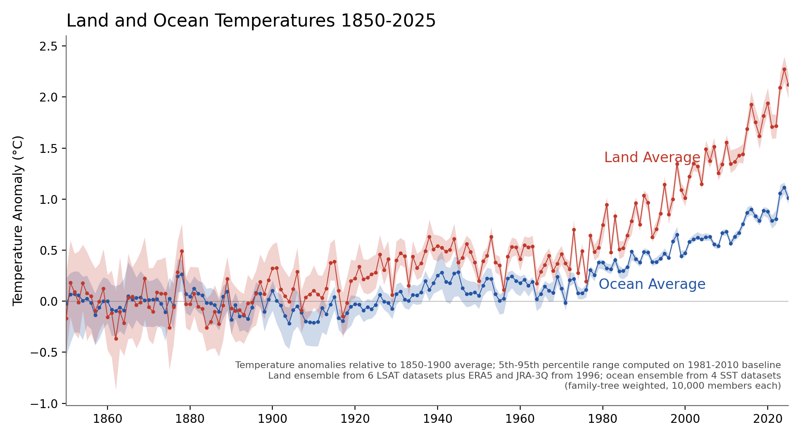

# Land and Ocean Temperature Ensembles

10,000-member annual ensembles of **global land surface air temperature
(LSAT)** and **global sea surface temperature (SST)**, 1850–2025, built
from six LSAT products and four SST products via a Thorne et al. (2026)
style family-tree weighting. Each component product contributes either a
native ensemble or a σ-synthesized / donor-imputed pseudo-ensemble; the
final 10,000 draws sample across products by equal-weight method
families.

This work uses the same overall framework as the Thorne et al. (2026)
SST-grouped GMST ensemble, applied independently to LSAT and SST to
produce two component-domain ensembles.

## Headline result



| Year | LSAT median | LSAT 5–95% | SST median | SST 5–95% |
|------|------------:|----------:|----------:|---------:|
| 1850 | −0.17 °C    | −0.50 to +0.29 | −0.03 °C | −0.50 to +0.24 |
| 1900 | +0.32 °C    | +0.07 to +0.56 | +0.11 °C | −0.09 to +0.21 |
| 1950 | +0.20 °C    | +0.10 to +0.30 | +0.06 °C | −0.06 to +0.16 |
| 2000 | +1.01 °C    | +0.96 to +1.10 | +0.48 °C | +0.46 to +0.49 |
| 2024 | +2.26 °C    | +2.15 to +2.41 | +1.13 °C | +1.06 to +1.16 |
| 2025 | +2.09 °C    | +1.98 to +2.23 | +1.02 °C | +0.95 to +1.04 |

*Anomalies relative to the 1850–1900 average. Percentiles are computed
on the 1981–2010 modern baseline (where the ensembles have minimum
spread by construction) and then shifted by a constant offset so the
median has zero mean over 1850–1900 — the "modern baseline plus
offset" approach. This preserves the modern-era uncertainty
representation while reporting against preindustrial. Offsets:
land +1.02 °C, ocean +0.49 °C.*

## Datasets

### LSAT (6 products)

| Dataset | Native ensemble | Time | Source |
|---------|-----------------|------|--------|
| Berkeley Earth High-Res Land | 10 native members | 1750–2026 | `berkeleyearth.org` |
| CRUTEM 5.2.0.0 | No (200 synth from published annual σ components) | 1857–2026 | `metoffice.gov.uk/hadobs/crutem5` |
| GloSATLAT 1.0.0.0 | No (200 synth from published annual σ components) | 1781–2021 | CEDA (`catalogue.ceda.ac.uk`) |
| DCLSAT-I (DCENT-I v1.1.0.0, native `lsat` field) | 200 native members (infilled) | 1850–2025 | Harvard Dataverse `doi:10.7910/DVN/ROG38Q` |
| NOAA Land v6.1.0 | No (200 synth: own best estimate + CRUTEM5 error model) | 1850–2026 | `ncei.noaa.gov/.../noaa-global-surface-temperature/v6.1` |
| C-LSAT 2.1 (CMA homogenization) | No (200 synth: own best estimate + CRUTEM5 error model) | 1850–2025 | `gwpu.net` / [figshare:28255394](https://doi.org/10.6084/m9.figshare.28255394) |

### SST (4 method families; 5 leaves)

| Dataset | Native ensemble | Time | Source |
|---------|-----------------|------|--------|
| HadSST 4.2.0.0 | 200 native bias members + σ noise | 1850–2026 | `metoffice.gov.uk/hadobs/hadsst4` |
| ERSSTv6 (NOAA pre-release ensemble) | 1000 native members + frozen-offset fallback at the 2025 boundary | 1850–2025 | `ncei.noaa.gov/pub/data/cmb/ersst/v5/tmp/ersstv6.ensemble/` (contact `boyin.huang@noaa.gov`) |
| COBE-SST 3 (Ishii et al., 2025) | 300 native perturbation members (1870–2024) + HadSST4-donor sibling around SST3's best estimate (1850–2024) | 1850–2024 | `climate.mri-jma.go.jp/pub/archives/Ishii-et-al_COBE-SST3/` |
| DCENT-I SST (v1.1.0.0, native `sst` field) | 200 native members (infilled) | 1850–2025 | Harvard Dataverse `doi:10.7910/DVN/ROG38Q` |

Within the COBE method family, two SST3 sibling leaves (native
perturbations and HadSST4-donor wrap) share P=1/8 each inside
1870–2024; outside that window the donor sibling absorbs the branch
in 1850–1869, and in 2025+ the COBE family contributes 0 while the
other three families renormalise. See
[`ocean_ensemble_methodology.md`](ocean_ensemble_methodology.md) §2.4
and §2.5 for the full description. COBE-SST2 was used in earlier
versions and is retired in favour of SST3; the SST2 prep script and
its CSV are retained for archival cross-checks.

## Methodology

See the two methodology documents:

- [`land_ensemble_methodology.md`](land_ensemble_methodology.md)
- [`ocean_ensemble_methodology.md`](ocean_ensemble_methodology.md)

Both follow the same five-step structure: (1) annualize & truncate to
1850–2025; (2) build a per-dataset 200-member (or native 10-member)
ensemble; (3) re-baseline to 1981–2010 member-wise; (4) apply a method-
family tree to assign leaf probabilities; (5) sample 10,000 final
members by primary-leaf assignment + within-leaf member draw.

The family trees are visualised in `family_tree_land.png` and
`family_tree_ocean.png`.

## Repository contents

```
land_ocean_temps/
├── README.md                         # this file
├── land_ensemble_methodology.md
├── ocean_ensemble_methodology.md
│
├── download_data.sh                  # fetch raw datasets into Land Data/ + Ocean Data/
├── pull_dcent_i_members.py           # data prep: DCENT-I 200 members → LSAT + SST CSVs
├── pull_ersstv6_members.py           # data prep: ERSSTv6 1000 native members
├── pull_cobe_sst3_members.py         # data prep: COBE-SST3 300 native perturbations
├── prepare_hadsst_global_ensemble.py # data prep: HadSST4 gridded → 200 globals
├── prepare_cobe_sst3_global_mean.py  # data prep: COBE-SST3 best estimate → anomaly CSV
├── prepare_cobe_global_mean.py       # data prep: COBE-SST2 NetCDF → anomaly CSV (archival)
├── prepare_c_lsat_global_mean.py     # data prep: C-LSAT 2.1 NetCDF → anomaly CSV
├── prepare_era5_5deg.py              # data prep: ERA5 monthly 2 m T → CRUTEM5 5° grid
├── estimate_coverage_persistence.py  # CRUTEM5 coverage-error persistence from masked ERA5
├── coverage_persistence_fit.json     # its output (p, φ), read by the land build
├── lsat_synthesis.py                 # annual pseudo-ensembles from published σ components
├── dcent_i_member_fileids.json       # Harvard Dataverse manifest for DCENT-I v1.1.0.0
│
├── build_land_ensemble.py            # core: 10,000-member LSAT builder
├── build_ocean_ensemble.py           # core: 10,000-member SST builder
│
├── plot_land_ensemble.py             # plot: land best estimate + 95% band
├── plot_ocean_ensemble.py            # plot: ocean best estimate + 95% band
├── plot_land_ocean_combined.py       # plot: land + ocean overlay
├── plot_family_trees.py              # plot: dendrogram for each family tree
│
├── land_ensemble.csv                 # output: 176 × 10,001
├── land_ensemble_summary.csv         # output: annual mean, p2.5/50/97.5, σ
├── land_ensemble_perdataset.csv      # output: per-dataset mean and σ
├── ocean_ensemble.csv                # output: 176 × 10,001
├── ocean_ensemble_summary.csv
├── ocean_ensemble_perdataset.csv
│
└── *.png                             # figures
```

## Reproduction

### 1. Environment

```bash
python3 -m venv venv && source venv/bin/activate
pip install numpy pandas xarray netCDF4 matplotlib
```

### 2. Download raw datasets

Run `bash download_data.sh` from the repo root (creates `Land Data/`
and `Ocean Data/` with all required files). Total download ≈ 2.5 GB
of which 1.7 GB is the HadSST4 200-member gridded ensemble. After
extraction the raw NetCDFs are deleted by the prep scripts — final
on-disk footprint is closer to 100 MB.

The HadSST4 gridded ensemble dominates the download. If you only
want the central estimates and the σ-synthesized pseudo-ensembles
you can skip the four HadSST4 ensemble zips (`*_ensemble_members_*`)
and edit `prepare_hadsst_global_ensemble.py` accordingly — but you
will lose the native bias-dimension covariance.

### 3. Prepare derived global means (one-time)

```bash
python3 pull_dcent_i_members.py               # ~17 min, ~42 MB peak transient (LSAT + SST in one pass)
python3 pull_ersstv6_members.py               # ~2.7 hr, ~135 MB transient (iterative)
python3 pull_cobe_sst3_members.py             # ~3-15 hr, ~155 MB transient (per-member streaming)
python3 prepare_hadsst_global_ensemble.py     # ~30 s
python3 prepare_cobe_sst3_global_mean.py      # ~3 min
python3 prepare_c_lsat_global_mean.py         # ~2 s
python3 prepare_era5_5deg.py ERA5_T2M.nc ERA5_LSM.nc   # ~2 min; see below
python3 estimate_coverage_persistence.py      # ~5 s; writes coverage_persistence_fit.json
```

The last two steps are needed only to re-derive the coverage-error
persistence (`coverage_persistence_fit.json` is committed). They need
ERA5 monthly-mean 2 m temperature (0.25°, 1940 onward, ~1.4 GB) and the
ERA5 land-sea mask from the Copernicus Climate Data Store
(`reanalysis-era5-single-levels-monthly-means`); the reduced 5° file is
about 25 MB.

These read from `Land Data/` and `Ocean Data/` and write derived CSV
files alongside their inputs.

### 4. Build the ensembles

```bash
python3 build_land_ensemble.py
python3 build_ocean_ensemble.py
```

`build_land_ensemble.py --help` lists the sensitivity options (coverage
persistence, recentred CRU-lineage bias, and the pre-2026-11 legacy
synthesis via `--method legacy`).

Writes `land_ensemble.csv`, `ocean_ensemble.csv`, summary CSVs, and
per-dataset diagnostics.

### 5. Plot

```bash
python3 plot_land_ensemble.py
python3 plot_ocean_ensemble.py
python3 plot_land_ocean_combined.py
python3 plot_family_trees.py
```

## Citation

If you use these ensembles, please cite the underlying methodology paper:

> Thorne, P. W. et al. (2026). *A framework for an operational
> assessment of observed global warming-to-date*. ESSD preprint
> [`https://doi.org/10.5194/essd-2025-825`](https://doi.org/10.5194/essd-2025-825).

…together with the individual dataset references listed in the two
methodology MDs.

## License

Code: MIT (see `LICENSE`). Output ensemble CSVs are subject to the
licenses of their underlying input datasets — see the methodology MDs
for per-dataset references and licensing terms (CRUTEM5 / HadSST4 /
GloSATLAT: Open Government Licence v3; NOAA / NCEI: public domain;
Berkeley Earth: CC BY 4.0; DCENT: CC0 via Harvard Dataverse;
COBE-SST3: JMA/MRI archive, non-commercial use only).
